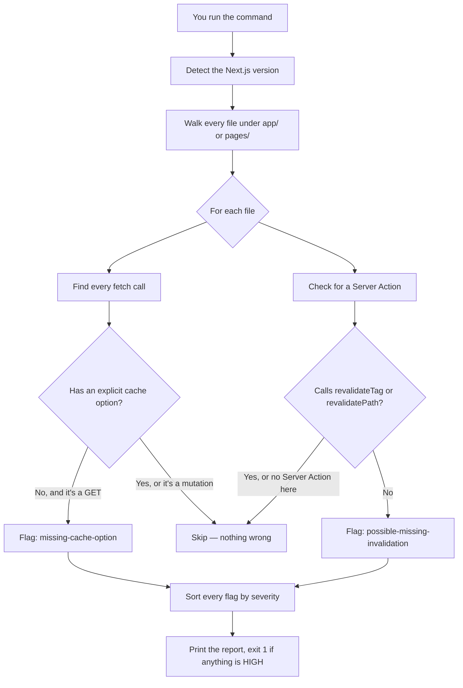

# cache-inspector-scan

Scans a Next.js App Router project for real caching mistakes and reports
them in plain language, with the exact file and line. Zero dependencies —
reads local files only, no network access, nothing leaves your machine.

## Install

```bash
npm link
```

Run once, from inside this folder. No `npm install` needed first — this
package has zero dependencies, so there's nothing to install. `npm link`
alone makes `cache-inspector-scan` a permanent command on your system.

## Usage

Run it from inside any Next.js project:

```bash
cache-inspector-scan
```

Or point it at a project without `cd`-ing into it first:

```bash
cache-inspector-scan /path/to/project
```

## How it works



Five steps, in order, every time:

1. **You run `cache-inspector-scan`.** No arguments needed — whatever
   folder your terminal is currently sitting in becomes the target.
2. **It detects your real Next.js version** — checks
   `node_modules/next/package.json` first (the actual installed version),
   falls back to the version range declared in `package.json` if that
   folder isn't there yet. This matters because Next.js's caching default
   for `fetch()` changed in version 15 — the tool needs to know which
   rules apply to explain findings correctly.
3. **It walks every `.ts`, `.tsx`, `.js`, and `.jsx` file** under `app/`,
   `pages/`, `src/app/`, or `src/pages/` — whichever exist — skipping
   `node_modules`, `.next`, and `.git`.
4. **It checks each file for two specific patterns:**
   - Every `fetch(...)` call is extracted with real balanced-parenthesis
     parsing (not a naive regex, so multi-line option objects are handled
     correctly). Mutating requests (`method: 'POST'`/`PUT`/`DELETE`/`PATCH`)
     are skipped — caching isn't the relevant question for those. What's
     left is checked for an explicit `cache:` or `next: { revalidate }`
     option; if neither is present, that's a finding.
   - If the file contains a Server Action (`'use server'`), it's checked
     for an actual `revalidateTag(...)` or `revalidatePath(...)` **call** —
     not just those words appearing anywhere, since a comment mentioning
     them shouldn't count as one being present. No call found, no
     Server Action-mutation without invalidation: that's a finding too.
5. **Every finding is sorted by severity and printed** — file, line,
   the exact code snippet, and a plain-language explanation with a fix.
   If anything is HIGH severity, the command exits with code `1`, so it
   can fail a CI build automatically.

## Options

```
cache-inspector-scan [path]        Scan a project (default: current folder)
cache-inspector-scan --json [path] Print results as JSON
cache-inspector-scan --help        Show usage
cache-inspector-scan --version     Show version
```

## What it checks

**1. `fetch()` calls with no explicit cache option.**
On Next.js 14 and earlier, this is cached indefinitely by default. On
Next.js 15+, the default flipped — it's not cached at all unless you opt
in. A lot of beginner and intermediate developers don't know that changed,
so this is flagged HIGH severity on 15+ and LOW on 14 and earlier.

**2. Server Actions with no `revalidateTag`/`revalidatePath` call.**
A heuristic, not a certainty — the invalidation call might legitimately
live in a different file. Flagged as medium severity, worth a manual check.

This is not a full audit. It catches these two specific, common mistakes
and explains each one clearly.

## Exit codes

| Code | Meaning |
|---|---|
| `0` | Scan completed, nothing HIGH severity found |
| `1` | Scan completed, at least one HIGH severity issue found |
| `2` | Couldn't run the scan (bad path, etc.) |

## Example output

```
Cache Inspector scan — /Users/you/my-app
Next.js version detected: 16
Scanned: app  (8 files)

Found 1 thing worth a look: 1 high, 0 medium, 0 low

[HIGH] app/products/page.tsx:2
   fetch('https://api.example.com/products')
   -> Next.js 16: a fetch with no cache option is NOT cached by default
      (this changed in Next.js 15). If you wanted this cached, this is
      probably a bug.
```

## Uninstall

```bash
npm unlink -g cache-inspector-scan
```

## License

MIT
