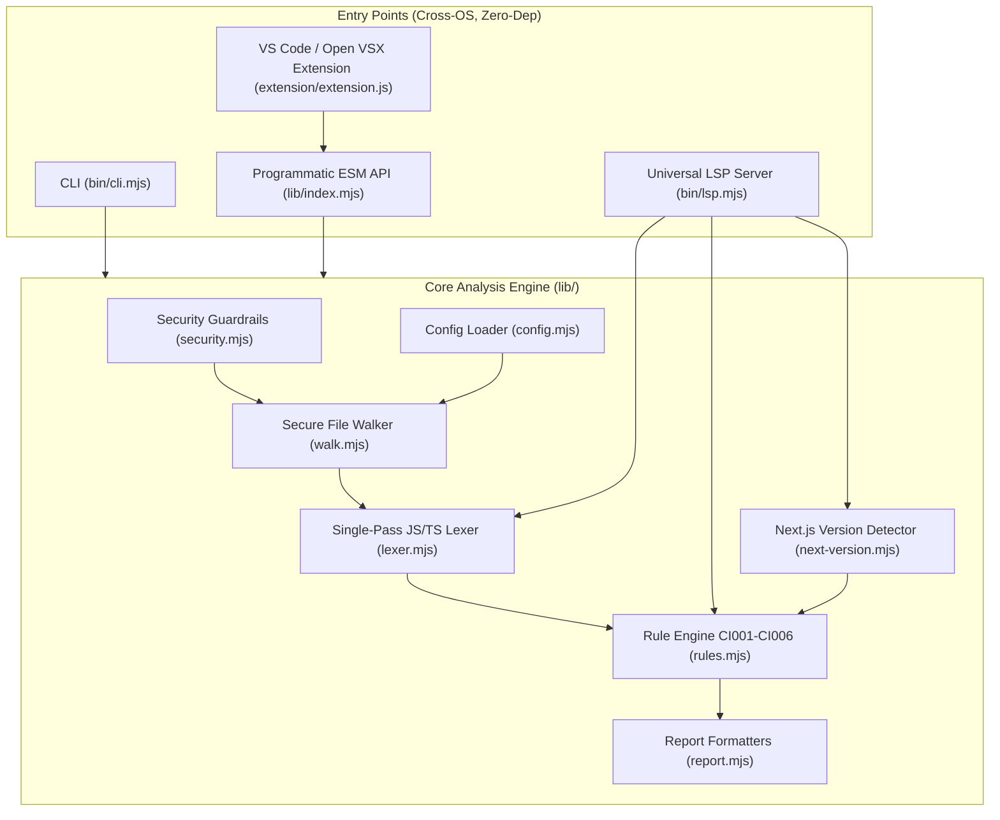

# System Architecture — `cache-inspector-scan`

## 1. High-Level Architecture

## 2. Module Responsibilities

| Module | Responsibility |
|---|---|
| `lib/security.mjs` | Canonical root resolution, symlink containment checks, resource limits (`MAX_FILE_SIZE_BYTES`, `MAX_FILES`, `MAX_DEPTH`), CWE-150 ANSI sanitization, prototype-pollution-safe JSON parsing. |
| `lib/lexer.mjs` | Single-pass $O(N)$ JS/TS/JSX tokenizer producing `codeOnly` (comment/string/regex-masked mirror), `stringLiterals`, `comments`, and $O(\log L)$ `lineStarts` index. |
| `lib/next-version.mjs` | Monorepo-aware upward search (up to 5 parent dirs) for installed `node_modules/next/package.json`, with fallback to `package.json` semver ranges. |
| `lib/config.mjs` | Strictly JSON-only `.cacheinspectorrc.json` / `cache-inspector.config.json` loader with schema & path-traversal validation. |
| `lib/walk.mjs` | Deterministic, sorted, symlink-safe recursive directory walker with ignore matching and skipped-file telemetry. |
| `lib/fetch-scanner.mjs` | Lexer-backed balanced-parenthesis `fetch()` extractor, explicit cache option detector, conflicting option detector, and mutating method filter. |
| `lib/action-scanner.mjs` | Directive-accurate `'use server'` detector and invalidation call checker (`revalidateTag`, `revalidatePath`, `updateTag`, `refresh`). |
| `lib/rules.mjs` | Orchestrates rules `CI001`–`CI006`, `'use client'` / `pages/` / segment-config awareness, severity overrides, and inline suppressions. |
| `lib/scan.mjs` | Public `scanProject()` (disk) and `scanSource()` (in-memory editor buffers) orchestrators. |
| `lib/report.mjs` | Formatters for ANSI-safe `text`, versioned `json`, `sarif` 2.1.0, and `github` workflow annotations. |
| `lib/lsp-server.mjs` | Pure Node.js JSON-RPC 2.0 Language Server over stdio (`initialize`, `didOpen`, `didChange`, `didSave`, `didClose`, `codeAction`). |
| `extension/extension.js` | Universal VS Code / Cursor / Windsurf / VSCodium / Antigravity / Theia extension (`engines.vscode: ^1.60.0`) with zero native binaries. |

## 3. Universal IDE & OS Compatibility Strategy

1. **VS Code Ecosystem (Old & Latest)**: `extension/` targets `^1.60.0` using only stable core VS Code APIs (`DiagnosticCollection`, `CodeActionsProvider`, `StatusBarItem`), pure JS, and `path.sep`-agnostic POSIX normalization.
2. **Non-VS Code IDEs (Neovim, JetBrains, Sublime, Zed, Helix, Emacs)**: `bin/lsp.mjs` speaks standard LSP over stdio using only Node.js built-ins.
3. **Operating Systems (Windows, macOS, Linux)**: Zero native addons, zero shell invocations, `realpathSync` symlink resolution in CLI entrypoint, and POSIX `/` paths in all outputs.
