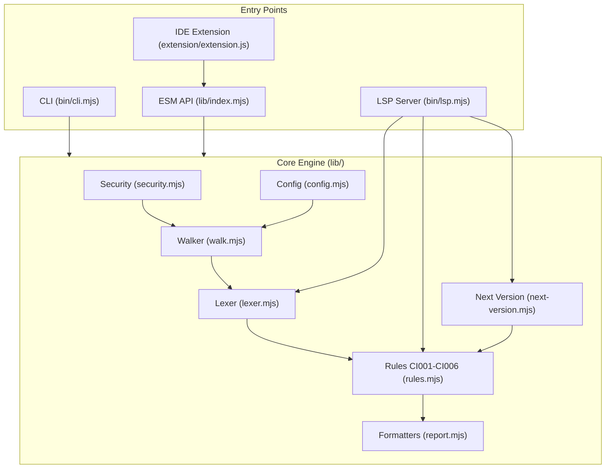

# Architecture: `cache-inspector-scan`

## System Overview

A single zero-dependency core in `lib/` powers all four entry points (CLI, programmatic API, LSP server, and VS Code / Open VSX extension).

## Modules

| File | Responsibility |
|---|---|
| `lib/security.mjs` | Canonical root validation, symlink containment, resource limits, ANSI escape sanitization, safe JSON parsing. |
| `lib/lexer.mjs` | Single-pass `O(n)` JS/TS/JSX masker producing `codeOnly`, `stringLiterals`, `comments`, and `O(log L)` `lineStarts`. |
| `lib/next-version.mjs` | Checks installed `node_modules/next/package.json` up to 5 parent directories (monorepos), then falls back to `package.json`. |
| `lib/config.mjs` | Loads `.cacheinspectorrc.json` or `cache-inspector.config.json` with strict JSON parsing and path validation. |
| `lib/walk.mjs` | Deterministic, sorted, symlink-safe recursive directory traversal with ignore matching and skip reasons. |
| `lib/fetch-scanner.mjs` | Balanced-parenthesis `fetch()` extraction, explicit cache detection, conflict detection, and mutating method filtering. |
| `lib/action-scanner.mjs` | `'use server'` directive detection and invalidation call checks (`revalidateTag`, `revalidatePath`, `updateTag`, `refresh`). |
| `lib/rules.mjs` | Runs rules `CI001`-`CI006`, skips `'use client'` and `pages/` where appropriate, applies overrides and inline suppressions. |
| `lib/scan.mjs` | Exposes `scanProject(dir, opts)` for disk scans and `scanSource(text, opts)` for in-memory editor buffers. |
| `lib/report.mjs` | Formats findings as ANSI-safe `text`, `json`, `sarif` (2.1.0), and `github` annotations. |
| `lib/lsp-server.mjs` | Pure Node.js JSON-RPC 2.0 Language Server over stdio (`initialize`, `didOpen`, `didChange`, `didSave`, `didClose`, `codeAction`). |
| `extension/extension.js` | VS Code / Open VSX extension (`engines.vscode: ^1.60.0`) using stable editor APIs and zero native binaries. |

## Distribution

- **npm (`cache-inspector-scan`)**: Publishes `bin/`, `lib/`, `types/`, `README.md`, and `LICENSE` (~22 kB tarball).
- **Open VSX (`abdullahjan.cache-inspector-vscode`)**: Packages `extension/` with `lib/` copied into `extension/core/` at build time via `extension/scripts/sync-core.mjs`, so the `.vsix` runs standalone without requiring the npm package in the workspace.
